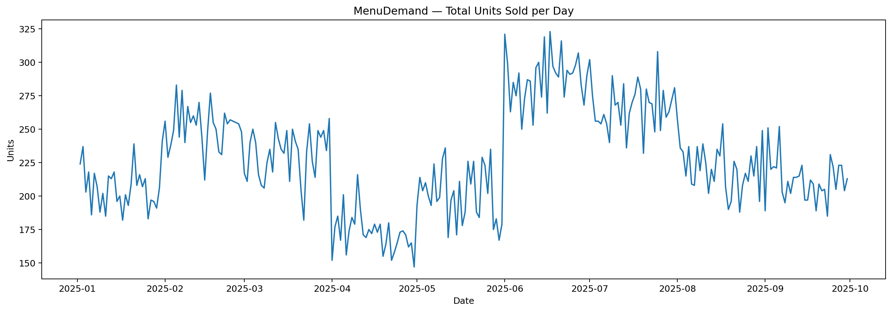
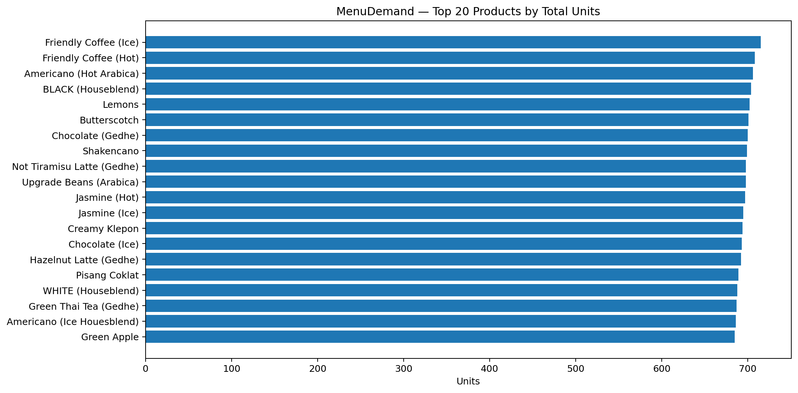
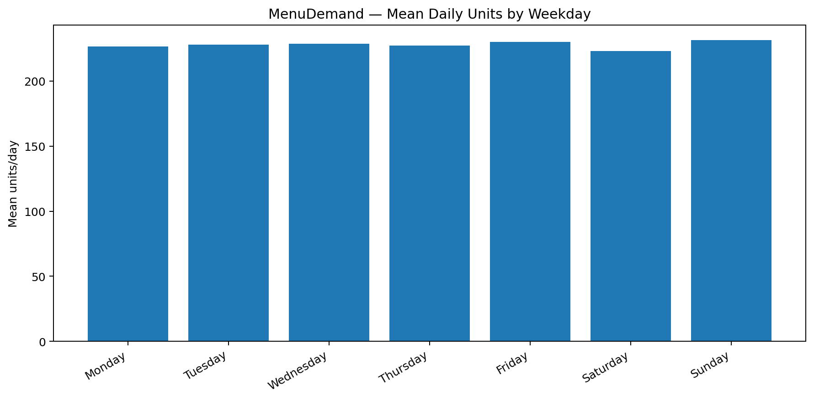
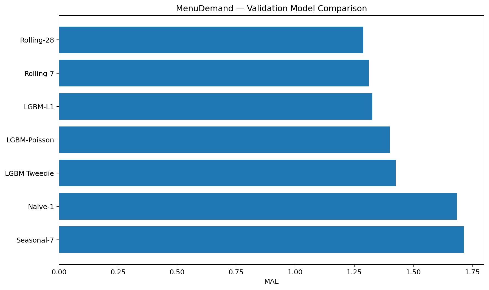
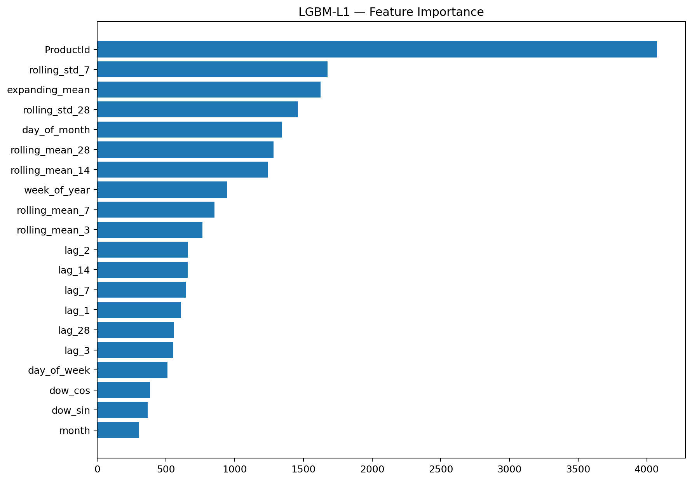
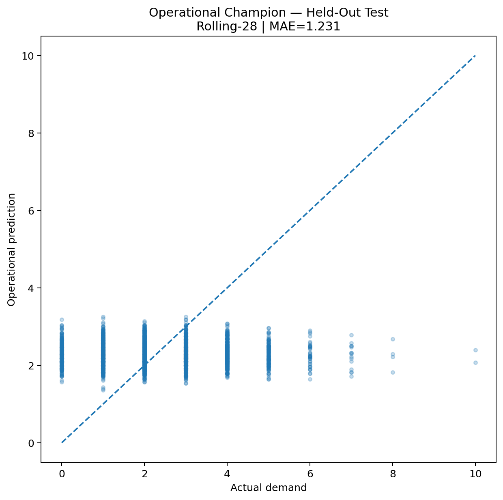
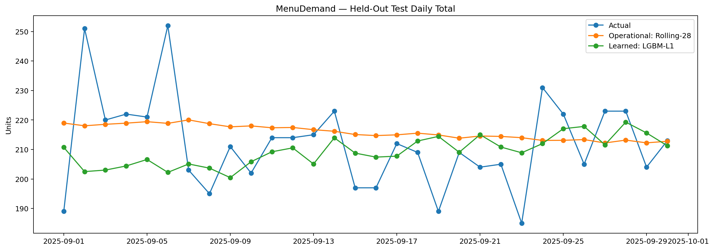
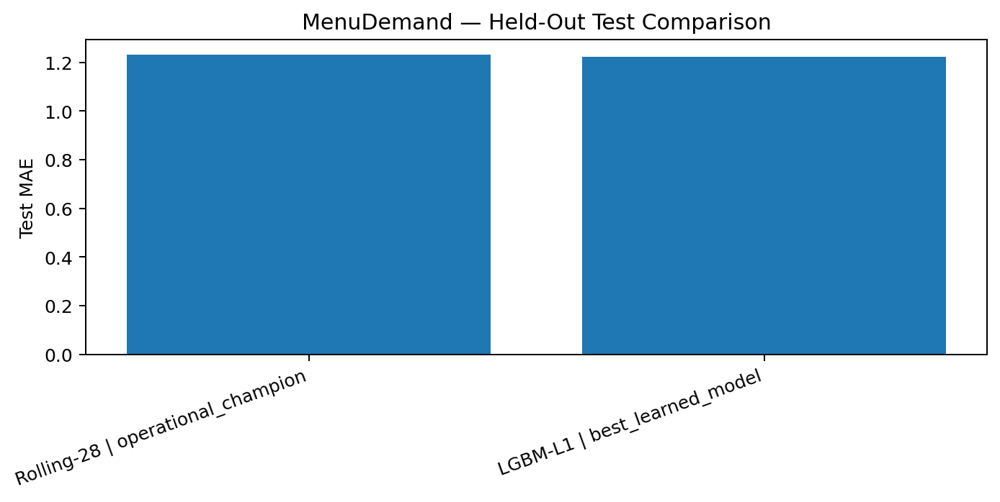
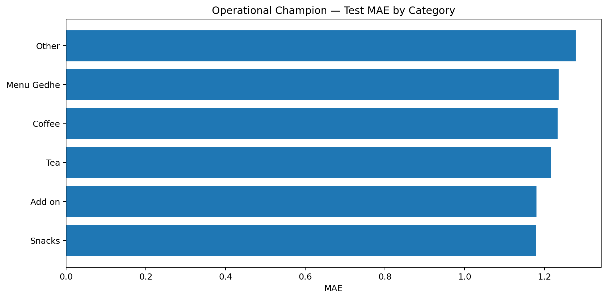
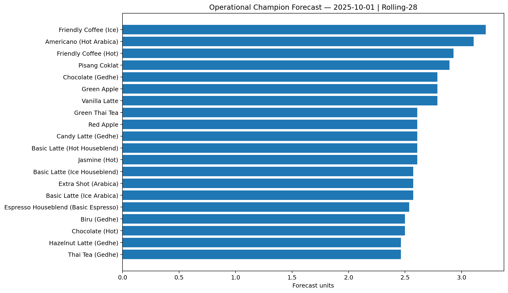

# ☕ MenuDemand Forecast

> **13% portfolio milestone — next-day menu-item demand forecasting with strict temporal validation, strong baselines, LightGBM comparison, and an interactive Streamlit inference app.**

[](https://www.python.org/)
[](https://lightgbm.readthedocs.io/)
[](https://streamlit.io/)
[](tests/)
[](LICENSE)

**Repository:** https://github.com/MENSTRUE/MenuDemand-Forecast

---

## Table of Contents

- [Project Overview](#project-overview)
- [Before → Now → Next](#before--now--next)
- [Problem Statement](#problem-statement)
- [Product Goal](#product-goal)
- [Claim Boundaries](#claim-boundaries)
- [Dataset](#dataset)
- [Data Audit](#data-audit)
- [Why Product × Day?](#why-product--day)
- [Forecasting Protocol](#forecasting-protocol)
- [Feature Engineering](#feature-engineering)
- [Experiments](#experiments)
- [Model Selection](#model-selection)
- [Final Metrics](#final-metrics)
- [Visual Evidence](#visual-evidence)
- [Next-Day Forecast Artifact](#next-day-forecast-artifact)
- [Application](#application)
- [Input Schema](#input-schema)
- [Repository Structure](#repository-structure)
- [Installation](#installation)
- [Run the App](#run-the-app)
- [Programmatic Inference](#programmatic-inference)
- [Testing](#testing)
- [Reproducibility](#reproducibility)
- [Deployment](#deployment)
- [Failure Modes](#failure-modes)
- [Limitations](#limitations)
- [Responsible Use](#responsible-use)
- [Reports and Artifacts](#reports-and-artifacts)
- [Roadmap](#roadmap)
- [Troubleshooting](#troubleshooting)
- [FAQ](#faq)
- [License](#license)
- [Author](#author)

---

## Project Overview

**MenuDemand Forecast** is an MVP for **next-day product-level unit demand forecasting**.

The project starts from transactional receipt data, converts it into a complete daily demand panel, compares simple forecasting baselines against learned LightGBM models, selects the operational method **only from validation performance**, evaluates once on a held-out temporal test set, and exposes inference through Streamlit.

The central engineering decision is intentionally simple:

> **Rolling-28 is the operational champion because it achieved the lowest validation MAE.**

A LightGBM L1 model is preserved as the **best learned model**, but it does not replace the operational champion merely because it obtains a slightly lower MAE on the final test set.

This is deliberate. The test set is for final evaluation, not model selection.

### Current identity

| Item | Value |
|---|---|
| Portfolio progress | **13%** |
| Task | Next-day product-level unit demand forecasting |
| Forecast horizon | **1 day ahead** |
| Granularity | **Product × Day** |
| Operational champion | **Rolling-28** |
| Best learned model | **LightGBM L1** |
| Selection metric | **Validation MAE** |
| Test protocol | Rolling one-day-ahead |
| App | Streamlit |
| License | MIT |

---

## Before → Now → Next

### Before

The source data existed as transactional receipts plus a product catalog. That form is useful for transaction history, but not directly suitable for supervised next-day forecasting.

The project still needed to answer several fundamental questions:

- What exactly is the target?
- Should demand be modeled per outlet or across outlets?
- Is revenue a safe target?
- Are all catalog items actually active?
- Are transaction items parsed correctly?
- Are dates continuous?
- Which baseline is strong enough to beat?
- Does a learned model actually add enough value to justify operational complexity?
- How should the final forecasting logic be exposed as a usable application?

### Now

The repository contains a complete MVP pipeline:

- raw-data audit;
- item parsing audit;
- complete Product × Day panel;
- temporal train/validation/test split;
- multiple naive/rolling baselines;
- multiple LightGBM objectives;
- validation-only champion selection;
- held-out test evaluation;
- next-day forecast artifact;
- serialized best learned model;
- Streamlit upload → validate → forecast → inspect → export flow;
- inference tests;
- experiment reports and plots.

### Next

The strongest next improvements are not “make the model bigger.” They are to improve the information available to the forecast:

- outlet-aware modeling when enough signal exists;
- promotion and discount features;
- stockout and inventory-on-hand signals;
- holiday/event/weather features;
- calibrated decision support for purchasing/preparation;
- backtesting across multiple rolling windows;
- model monitoring and drift detection;
- safer production deployment and input schema versioning.

---

## Problem Statement

Daily sales histories often become passive records instead of operational signals.

For an F&B workflow, a practical question is:

> **Given the product-level sales history available up to today, how many units of each product are likely to be demanded tomorrow?**

This project answers that question at the **Product × Day** level.

For Rolling-28:

```text
next-day forecast = mean(previous 28 daily demand observations)
```

---

## Product Goal

The MVP is designed to support a lightweight forecasting workflow:

1. upload recent historical daily sales;
2. validate the schema and history length;
3. choose the operational Rolling-28 method or the learned LightGBM comparison;
4. generate a next-day forecast;
5. inspect high-demand items and product history;
6. export the forecast to CSV.

It is a forecasting aid, **not an autonomous inventory decision system**.

---

## Claim Boundaries

### Supported claims

This repository supports the following claims:

- next-day menu-item demand forecasting;
- product-level daily unit forecasting;
- strict temporal held-out evaluation;
- baseline-versus-ML validation comparison;
- historical lag, rolling, and calendar feature engineering;
- interactive next-day inference from uploaded historical sales.

### Unsupported claims

Do **not** describe this project as any of the following:

- proven inventory optimization;
- stockout prediction;
- causal promotion uplift estimation;
- universal restaurant demand forecasting;
- long-horizon recursive forecasting;
- guaranteed future sales;
- outlet-level operational forecasting;
- a system that knows future weather/events/promotions unless those signals are explicitly added.

---

## Dataset

### Source used in the experiment

The experiment uses the dataset identified in the project artifacts as **Anonymous Transactional Dataset**.

The training notebook worked from:

- `Transactions.csv`
- `Products.csv`

The raw source dataset is **not redistributed in this repository**.

### Audited source summary

| Audit item | Value |
|---|---:|
| Transaction rows / receipts | **53,820** |
| Product catalog rows | **96** |
| Parsed units | **61,973** |
| Active products | **94** |
| Inactive catalog products | **2** |
| Outlets | **3** |
| Unique calendar days | **272** |
| Date range | **2025-01-02 → 2025-09-30** |
| Missing calendar days | **0** |
| Duplicate receipt IDs | **0** |
| Null cells in transaction table | **0** |
| Null cells in product table | **0** |
| Unmapped parsed items | **0** |

Inactive catalog products:

- `Add on Aren`
- `Add on Simple Syrup`

There were **1,733 loyalty receipts** whose `TotalAmount` behavior made revenue unsuitable as the primary demand target. The target is therefore **units sold**.

---

## Data Audit

### Item parsing integrity

| Quantity | Value |
|---|---:|
| Declared total units | **61,973** |
| Parsed total units | **61,973** |
| Difference | **0** |

No transaction item failed catalog mapping.

### Product × Day panel

| Statistic | Value |
|---|---:|
| Active products | **94** |
| Days | **272** |
| Panel rows | **25,568** |
| Zero-demand rate | **9.63%** |
| Mean daily demand | **2.424** |
| Median | **2** |
| P90 | **5** |
| P95 | **5** |
| P99 | **7** |
| Maximum | **10** |

The row count is exactly `94 × 272 = 25,568`.

---

## Why Product × Day?

| Granularity | Zero-demand rate | Mean demand |
|---|---:|---:|
| **Product × Day** | **9.63%** | **2.424** |
| Outlet × Product × Day | 46.82% | 0.808 |

The outlet-specific panel was much sparser, so Product × Day was selected for this MVP. This does **not** mean outlet differences are unimportant; they are deferred until the data supports the additional sparsity and complexity.

---

## Forecasting Protocol

No random split is used.

| Split | Rows | Period |
|---|---:|---|
| Train | **17,202** | 2025-01-30 → 2025-07-31 |
| Validation | **2,914** | 2025-08-01 → 2025-08-31 |
| Test | **2,820** | 2025-09-01 → 2025-09-30 |

> **All champion selection is based on validation MAE only.**

The official test uses **rolling one-day-ahead forecasting**. The project does not claim recursive multi-week performance.

---

## Feature Engineering

### Identity / metadata

- `ProductId`
- `Category`
- `Price`

### Lag features

- `lag_1`
- `lag_2`
- `lag_3`
- `lag_7`
- `lag_14`
- `lag_28`

### Rolling statistics

- `rolling_mean_3`
- `rolling_mean_7`
- `rolling_mean_14`
- `rolling_mean_28`
- `rolling_std_7`
- `rolling_std_28`
- `expanding_mean`

### Calendar features

- day of week;
- day of month;
- ISO week of year;
- month;
- weekend flag;
- cyclical sine/cosine encodings.

---

## Experiments

| Model | Type | Validation MAE | RMSE | WAPE | Bias |
|---|---|---:|---:|---:|---:|
| **Rolling-28** | Baseline | **1.2895** | **1.5827** | **54.80%** | +0.2498 |
| Rolling-7 | Baseline | 1.3117 | 1.6327 | 55.74% | +0.0637 |
| **LGBM-L1** | Learned | **1.3268** | **1.6207** | **56.38%** | +0.4637 |
| LGBM-Poisson | Learned | 1.4016 | 1.6993 | 59.56% | +0.6234 |
| LGBM-Tweedie | Learned | 1.4258 | 1.7343 | 60.59% | +0.5909 |
| Naive-1 | Baseline | 1.6850 | 2.1442 | 71.61% | +0.0110 |
| Seasonal-7 | Baseline | 1.7152 | 2.1996 | 72.89% | +0.1222 |

A more complex model did not automatically win. The baseline was treated as a real competitor, not a formality.

---

## Model Selection

### Operational champion — Rolling-28

Validation:

- MAE: **1.2895**
- RMSE: **1.5827**
- WAPE: **54.80%**
- Bias: **+0.2498**

### Best learned model — LightGBM L1

Validation:

- MAE: **1.3268**
- RMSE: **1.6207**
- WAPE: **56.38%**
- Bias: **+0.4637**

Serialized artifact: `models/menudemand_best_learned_lgbm.joblib`

LightGBM has a slightly lower final test MAE, but that does **not** retroactively change the operational champion because the test set is not a model-selection set.

---

## Final Metrics

Official held-out period: **2025-09-01 → 2025-09-30**

| Metric | Rolling-28 — Operational | LightGBM L1 — Best learned |
|---|---:|---:|
| MAE | **1.2315** | **1.2234** |
| RMSE | **1.5407** | 1.5438 |
| WAPE | **54.60%** | **54.25%** |
| Bias | +0.0415 | -0.0273 |
| Mean actual | 2.2553 | 2.2553 |
| Mean predicted | 2.2968 | 2.2280 |
| N | 2,820 | 2,820 |

A MAE of roughly 1.23 means an average absolute product-day error of about **1.23 units** on this specific held-out period. It does not mean 98.77% accuracy.

---

## Visual Evidence

### Daily total demand



### Top products by total units



### Weekday demand pattern



### Validation model comparison



### Best learned model feature importance



Feature importance is descriptive, not causal.

### Actual vs operational prediction



### Test daily total comparison



### Operational vs learned test MAE



### Operational test MAE by category



### Next-day top-20 forecast



---

## Next-Day Forecast Artifact

The experiment includes a next-day forecast for **2025-10-01** using Rolling-28.

Artifact: [`reports/next_day_forecast.csv`](reports/next_day_forecast.csv)

Highest forecast in that file:

**Friendly Coffee (Ice): 3.2143 units → rounded display 3 units**

The rounded value is presentation-only; the underlying forecast remains continuous.

---

## Application

```text
Upload historical daily sales CSV
        ↓
Validate schema and minimum history
        ↓
Choose method
  ├─ Rolling-28 (operational default)
  └─ LightGBM L1 (comparison)
        ↓
Generate next-day forecast
        ↓
Inspect top products + table + product history
        ↓
Download forecast CSV / save local result
```

Current capabilities:

- CSV upload;
- schema validation;
- negative-demand validation;
- minimum 28-day history check;
- duplicate ProductId + Date guard;
- Rolling-28 inference;
- optional LightGBM comparison;
- top-demand chart;
- product inspector;
- recent 28-day history;
- CSV export;
- local result save to `tests/results/`.

---

## Input Schema

| Column | Meaning |
|---|---|
| `Date` | Historical date |
| `ProductId` | Product identifier |
| `ProductDisplay` | Human-readable product label |
| `Category` | Product category |
| `Price` | Product price used by the learned model |
| `demand` | Units sold on the date |

Example:

```csv
Date,ProductId,ProductDisplay,Category,Price,demand
2025-09-01,3,Air Mineral,Other,5000,1
2025-09-02,3,Air Mineral,Other,5000,3
2025-09-03,3,Air Mineral,Other,5000,2
```

Every product must have at least **28 distinct dates** and one row per `ProductId + Date`.

---

## Repository Structure

```text
MenuDemand-Forecast/
├── app/
│   └── app.py
├── assets/
│   ├── dataset/
│   ├── training/
│   ├── evaluation/
│   ├── predictions/
│   └── screenshots/
├── models/
│   └── menudemand_best_learned_lgbm.joblib
├── notebooks/
│   └── menudemand-forecast.ipynb
├── reports/
│   ├── final_summary.json
│   ├── forecast_config.json
│   ├── model_selection.json
│   ├── official_test_metrics.json
│   ├── next_day_forecast.csv
│   └── ...
├── src/
│   ├── __init__.py
│   ├── inference.py
│   └── utils.py
├── tests/
│   ├── results/
│   └── test_inference.py
├── .gitignore
├── AGENTS.md
├── LICENSE
├── README.md
└── requirements.txt
```

---

## Installation

```bash
git clone https://github.com/MENSTRUE/MenuDemand-Forecast.git
cd MenuDemand-Forecast
python -m venv .venv
```

Windows PowerShell:

```powershell
.\.venv\Scripts\Activate.ps1
```

Linux/macOS:

```bash
source .venv/bin/activate
```

Install:

```bash
python -m pip install --upgrade pip
python -m pip install -r requirements.txt
```

---

## Run the App

```bash
streamlit run app/app.py
```

Local URL is normally `http://localhost:8501`.

---

## Programmatic Inference

```python
import pandas as pd
from src.inference import MenuDemandForecaster

history = pd.read_csv("history.csv")
forecaster = MenuDemandForecaster()

forecast = forecaster.forecast(history, method="Rolling-28")
print(forecast.head())
```

Learned comparison:

```python
forecast = forecaster.forecast(history, method="LightGBM")
```

---

## Testing

Run:

```bash
python -m pytest -q
```

Current tests cover:

- valid history recognition;
- deterministic Rolling-28 behavior;
- next-day date calculation.

Before committing inference changes, run tests and manually verify app upload, forecast, and export.

---

## Reproducibility

### Experiment source

[`notebooks/menudemand-forecast.ipynb`](notebooks/menudemand-forecast.ipynb)

### Machine-readable reports

[`reports/`](reports/)

Key files:

- `final_summary.json`
- `raw_audit.json`
- `item_parsing_audit.json`
- `product_day_panel_audit.json`
- `model_selection.json`
- `official_test_metrics.json`
- `forecast_config.json`

### Inference implementation

[`src/inference.py`](src/inference.py)

If documentation conflicts with these report artifacts, do **not** silently rewrite historical metrics. Re-run the experiment and regenerate artifacts together.

---

## Deployment

### Local

```bash
streamlit run app/app.py
```

### Streamlit Community Cloud

Typical setup:

- repository: `MENSTRUE/MenuDemand-Forecast`
- branch: `main`
- entry point: `app/app.py`

Before production use, add schema versioning, stronger validation, privacy review, logging, drift monitoring, artifact versioning, access control, and deployment smoke tests.

---

## Failure Modes

### Demand spikes

Largest official errors include:

- Candy Latte: actual 10 vs Rolling-28 ≈ 2.07;
- Espresso Houseblend: actual 10 vs Rolling-28 ≈ 2.39;
- Americano (Ice Arabica): actual 8 vs Rolling-28 ≈ 1.82.

Without exogenous signals, spikes are difficult to predict from historical demand alone.

### Sparse outlet-level data

Outlet × Product × Day has a zero-demand rate near 46.82%.

### Regime changes

Menu, price, opening-hours, promo, and operating changes can reduce reliability.

### New products

Products with fewer than 28 days cannot use the current operational method without a separately validated cold-start policy.

---

## Limitations

1. Dataset is anonymized and may be synthetic or heavily curated.
2. Promotion data is unavailable.
3. Weather data is unavailable.
4. Stockout state is unavailable.
5. Inventory-on-hand is unavailable.
6. Event signals are unavailable.
7. Holiday effects are not explicitly modeled.
8. Forecasting is product-level across outlets, not outlet-specific.
9. Revenue is not the primary target.
10. External business shocks are not validated.
11. Evaluation is one-day-ahead, not recursive multi-week forecasting.
12. Operational champion is a simple baseline.
13. LightGBM feature importance is not causal explanation.
14. Forecasted units are estimates, not guaranteed sales.
15. Rounded units are display values, not optimized order quantities.

---

## Responsible Use

```text
forecast
   ↓
human review
   ↓
combine with stock / event / promo / business context
   ↓
operational decision
```

Do not present the output as certain future demand.

---

## Reports and Artifacts

### Audit

- [`raw_audit.json`](reports/raw_audit.json)
- [`item_parsing_audit.json`](reports/item_parsing_audit.json)
- [`product_day_panel_audit.json`](reports/product_day_panel_audit.json)
- [`granularity_comparison.json`](reports/granularity_comparison.json)

### Validation

- [`validation_baselines.csv`](reports/validation_baselines.csv)
- [`validation_learned_models.csv`](reports/validation_learned_models.csv)
- [`validation_model_comparison.csv`](reports/validation_model_comparison.csv)
- [`model_selection.json`](reports/model_selection.json)

### Test

- [`official_test_metrics.json`](reports/official_test_metrics.json)
- [`official_test_model_comparison.csv`](reports/official_test_model_comparison.csv)
- [`test_predictions.csv`](reports/test_predictions.csv)
- [`operational_worst_test_errors.csv`](reports/operational_worst_test_errors.csv)
- [`operational_test_metrics_per_category.csv`](reports/operational_test_metrics_per_category.csv)
- [`operational_test_metrics_per_product.csv`](reports/operational_test_metrics_per_product.csv)

### Forecasting

- [`forecast_config.json`](reports/forecast_config.json)
- [`next_day_forecast.csv`](reports/next_day_forecast.csv)

### Learned artifact

- [`menudemand_best_learned_lgbm.joblib`](models/menudemand_best_learned_lgbm.joblib)

---

## Roadmap

### Data

- [ ] Add promotion/discount variables.
- [ ] Add stockout and inventory-on-hand state.
- [ ] Add holiday/event context.
- [ ] Evaluate weather relevance.
- [ ] Add outlet-aware modeling when sparsity is manageable.
- [ ] Define new-product cold start.
- [ ] Document original dataset source/license more explicitly when provider metadata is available.

### Modeling

- [ ] Multi-window rolling backtests.
- [ ] Quantile forecasting / prediction intervals.
- [ ] Better treatment of high-demand spikes.
- [ ] Hierarchical product/category forecasts.
- [ ] Compare global vs per-category models.
- [ ] Re-check whether learned models consistently beat Rolling-28 across future windows.

### Product

- [ ] Add downloadable sample-input template.
- [ ] Add richer schema errors.
- [ ] Add side-by-side Rolling-28 vs LightGBM view.
- [ ] Add uncertainty presentation.
- [ ] Add category filters.
- [ ] Add polished app screenshots to `assets/screenshots/`.

### Deployment / MLOps

- [ ] CI for pytest.
- [ ] Dependency lock file.
- [ ] Artifact versioning.
- [ ] Inference logging.
- [ ] Data drift monitoring.
- [ ] Forecast error monitoring.
- [ ] Scheduled backtesting.
- [ ] Deployment smoke test.

---

## Troubleshooting

### `ModuleNotFoundError`

```bash
python -m pip install -r requirements.txt
streamlit run app/app.py
```

Run from repository root.

### LightGBM option is missing

Confirm `models/menudemand_best_learned_lgbm.joblib` exists.

### Fewer than 28 days of history

Each product needs at least 28 distinct dates. Do not duplicate rows to bypass validation.

### Duplicate ProductId + Date

Aggregate raw transactions to one daily row per product.

### Invalid dates

Use an unambiguous format such as `2025-09-30`.

### Forecast date looks wrong

Current rule: `forecast_date = max(uploaded Date) + 1 calendar day`.

### Rounded total differs from continuous total

Each product is rounded individually, so `sum(round(each))` can differ from `round(sum(raw))`.

### Streamlit deprecation warnings

UI deprecation warnings do not necessarily indicate forecasting failure. Update deprecated UI arguments separately from forecast logic.

---

## FAQ

### Why is Rolling-28 champion?

Because it had the lowest **validation MAE**.

### But LightGBM has lower test MAE. Why not switch?

Because the held-out test is not for model selection. Switching after seeing test performance would contaminate the evaluation protocol.

### Is WAPE 54.60% high?

Yes. It indicates meaningful relative error in this low-volume setting and is reported transparently. The project does not claim production-grade accuracy.

### Is this time-series forecasting?

Yes. It uses temporally ordered history and strict temporal splits. The learned model is tabular LightGBM with lag/rolling/calendar features.

### Does 3.21 mean exactly 3 units will sell?

No. It is a continuous point estimate. Rounded output is presentation-only.

### Can rounded forecast be used directly as inventory quantity?

Not safely. Inventory decisions need current stock, lead time, service level, waste/spoilage cost, and stockout cost.

### Does price cause demand?

No causal claim is supported.

### Why not revenue?

Audited loyalty-receipt behavior makes raw revenue unsuitable as the primary target for this project.

### Why not outlet-level?

The outlet-product-day panel was substantially sparser.

### Can this forecast a month ahead?

Not under the validated claims here. The official protocol is **one-day-ahead**.

---

## License

The **code in this repository** is released under the [MIT License](LICENSE).

The source dataset is separate from the repository and remains subject to the original provider's terms. The MIT license does not grant rights to third-party raw data.

---

## Author

**Wafa Bila Syaefurokhman**  
GitHub: [@MENSTRUE](https://github.com/MENSTRUE)

Built as part of a progressive AI/ML portfolio focused on turning experiments into auditable, usable MVPs.

---

## Final Project Principle

> **A more complex model is not automatically a better operational model.**

MenuDemand Forecast preserves the discipline:

**audit → baseline → temporal validation → locked selection → held-out test → usable inference → explicit limitations.**
